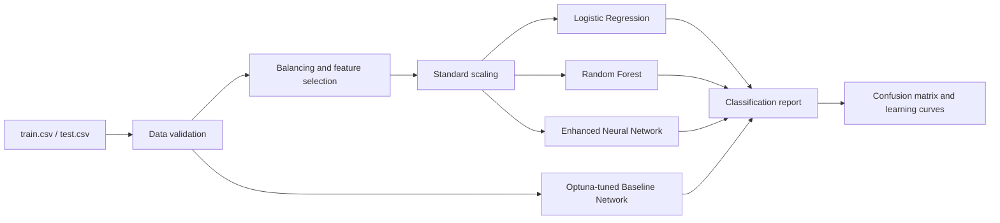

# Fake Instagram Profile Detection

An assessment project comparing traditional machine-learning models and neural networks for binary fake-profile classification.


## Overview

This project predicts whether an Instagram profile is genuine or fake using profile-level numerical and binary features. It evaluates logistic regression, random forests, a custom neural network, and an Optuna-tuned neural-network baseline.

The repository demonstrates preprocessing, reproducibility, class-distribution analysis, feature selection, hyperparameter optimization, regularized neural-network training, and evaluation with classification reports and confusion matrices.

## Features

- Reproducible experiments using a shared random seed
- Missing-value and class-distribution inspection
- Standard feature scaling
- Optional minority-class upsampling
- Low-variance feature removal
- Correlation-based feature filtering
- Random-forest feature-importance selection
- Logistic regression and random-forest baselines
- TensorFlow/Keras neural networks with batch normalization and dropout
- Optuna hyperparameter tuning
- Early stopping and adaptive learning-rate reduction
- Confusion matrices, classification reports, and learning curves

## Architecture



Two executable experiment paths are included:

- `NewModels.py` compares logistic regression, random forest, and an enhanced neural network after balancing and feature selection.
- `updated_baseline_model.py` uses Optuna to tune neural-network depth, width, dropout, and learning rate before fitting the selected configuration.

## Dataset

The committed dataset contains 576 training rows and 120 test rows. Both partitions are balanced between genuine and fake profiles.

Each row contains 11 input features:

- Profile-picture availability
- Numeric-character ratio in username and full name
- Number of words in the full name
- Whether name and username match
- Description length
- External-URL availability
- Private/public status
- Post, follower, and following counts

The target column is `fake`, where the stored binary value represents the profile class.

## Project Structure

```text
.
├── NewModels.py                  # ML models and enhanced neural network
├── updated_baseline_model.py     # Optuna-tuned neural-network baseline
├── train.csv                     # Training dataset
├── test.csv                      # Held-out test dataset
├── requirements.txt
└── README.md
```

## Setup

```bash
git clone https://github.com/SharathKumarReddyAlijarla/Classification_task_Context.git
cd Classification_task_Context
python -m venv .venv
```

Activate the environment on Windows:

```powershell
.\.venv\Scripts\Activate.ps1
```

Activate it on macOS or Linux:

```bash
source .venv/bin/activate
```

Install dependencies:

```bash
python -m pip install --upgrade pip
python -m pip install -r requirements.txt
```

## Usage

Run the multi-model comparison:

```bash
python NewModels.py
```

Run the tuned baseline experiment:

```bash
python updated_baseline_model.py
```

Both scripts expect `train.csv` and `test.csv` in the current working directory. Matplotlib windows display the class distribution, confusion matrix, and training curves during execution.

## Results

The following values were documented for the original assessment runs:

| Model | Precision | Recall | F1 score |
| --- | ---: | ---: | ---: |
| Original baseline | 88% | 88% | 88% |
| Logistic regression | 88% | 88% | 87% |
| Random forest | 92% | 92% | 92% |
| Enhanced neural network | 92% | 92% | 92% |
| Updated tuned baseline | 93% | 93% | 92% |

Exact results can vary with library versions, hardware, and the hyperparameters selected by Optuna. Rerun the scripts to obtain the classification report for the current environment.

## Technology Stack

| Area | Technology |
| --- | --- |
| Data processing | pandas, NumPy |
| Traditional ML | scikit-learn |
| Deep learning | TensorFlow, Keras |
| Hyperparameter tuning | Optuna |
| Visualization | Matplotlib, Seaborn |

## Limitations

- The dataset is small, so the reported scores may not generalize to broader social-media populations.
- Dataset provenance and reuse terms should be documented before redistribution or production use.
- Evaluation uses one fixed train/test partition rather than repeated cross-validation.
- The scripts do not save fitted preprocessing pipelines or trained models.
- The tuned baseline assumes the current 11-feature input schema.
- Profile classification can create fairness, privacy, and moderation risks; predictions should not be used as the sole basis for enforcement decisions.
- This is an assessment project, not a production fraud-detection service.
